<!--
Copyright (c) 2022 Nitro Agility S.r.l.
SPDX-License-Identifier: LicenseRef-Permguard-Admin-Binary
-->

# Permguard Admin

<p align="center">
  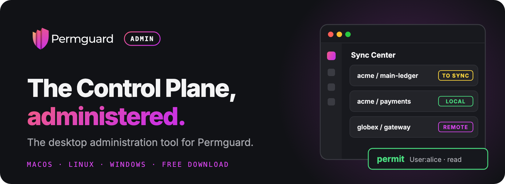
</p>

<p align="center">
  <a href="https://github.com/permguard/permguard-admin-releases/releases/latest"><b>Download</b></a> ·
  <a href="https://permguard.com"><b>Website</b></a> ·
  <a href="https://docs.permguard.com/"><b>Documentation</b></a> ·
  <a href="https://github.com/permguard/permguard"><b>Permguard</b></a>
</p>

**The desktop administration tool for the Permguard Control Plane.**

> [!WARNING]
> **Preview.** Permguard Admin is a preview release, not yet stable.
> Screens and behaviour may change from one version to the next, and some features are still experimental.
> Try it on development and test environments, and tell us what you find in the [issues](https://github.com/permguard/permguard-admin-releases/issues).

Permguard Admin is for the people who administer [Permguard](https://github.com/permguard/permguard).
Connect it to your Control Planes and manage them from one window: the server that hosts them, the ledgers and policies they serve, the events and decisions they record.
No terminal, no curl, no guessing.

<p align="center">
  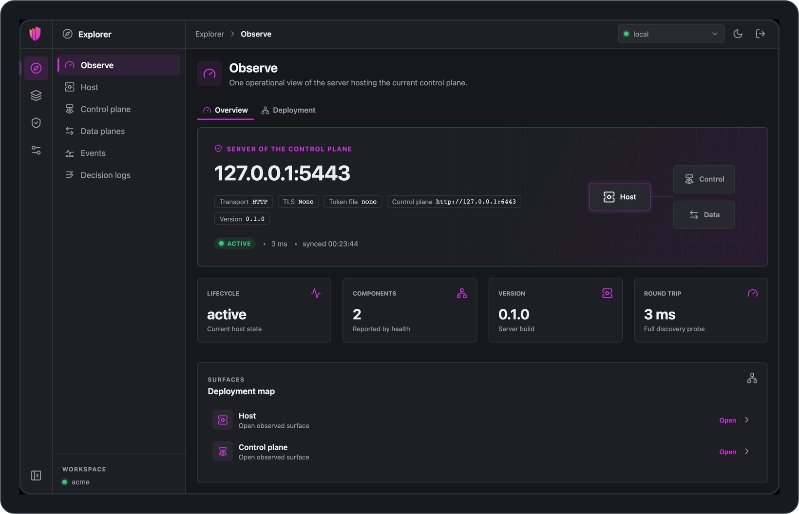
</p>

## What you can do

<p align="center">
  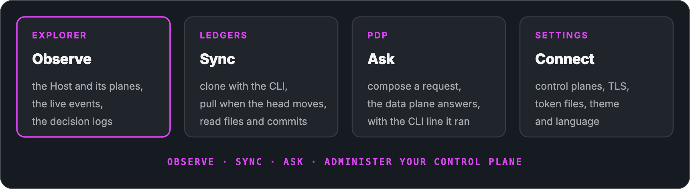
</p>

### Follow every event, live

Everything your data planes record, as it happens, in a stream you can read like logs.
A timeline shows the requests, responses and errors over the period you choose, from the last five minutes to the last thirty days.
Spot a spike, drag across it to zoom in, and the list below shows just those events.
Open any event to see when it happened, under which policies and commit, and its full payload.

<p align="center">
  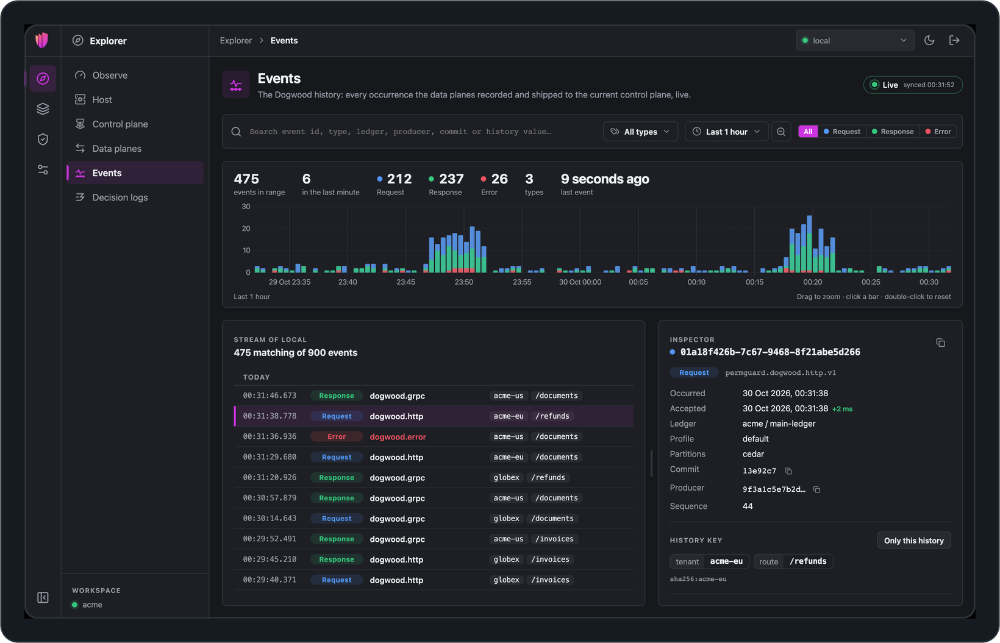
</p>

<details>
<summary><b>Zoom into a spike</b></summary>

<p align="center">
  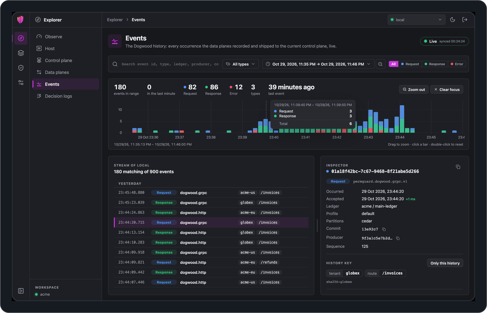
</p>

</details>

### See every decision

Every permit and every deny your data plane records, in one list.
Search by subject, action, resource or policy, filter by time and outcome, and open any decision to see the policies and the commit behind it.

<p align="center">
  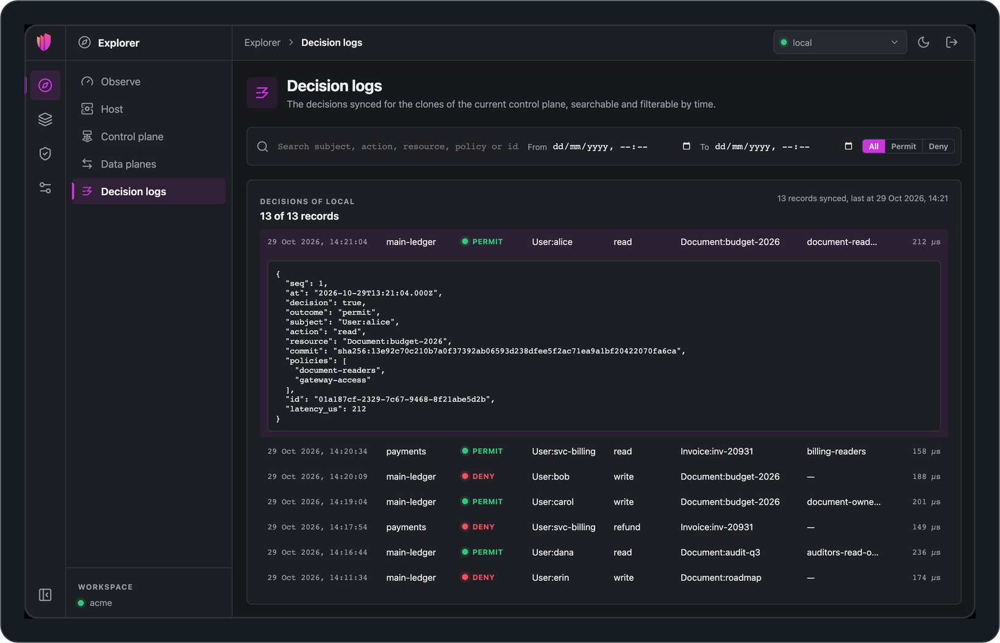
</p>

### Keep your ledgers at hand

The Sync Center lists every ledger your control plane serves.
Clone the ones you care about in one click, and Permguard Admin tells you the moment a new version is published, so you pull it when you are ready.

<p align="center">
  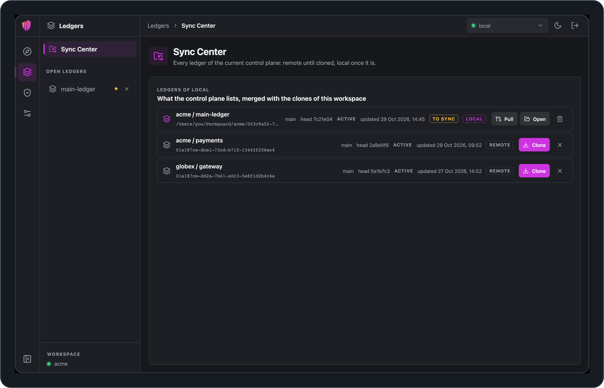
</p>

### Read every change to your policies

Open a ledger to browse its policies, and its history to see who changed what, when, and why.
Every commit shows its diff, line by line.

<p align="center">
  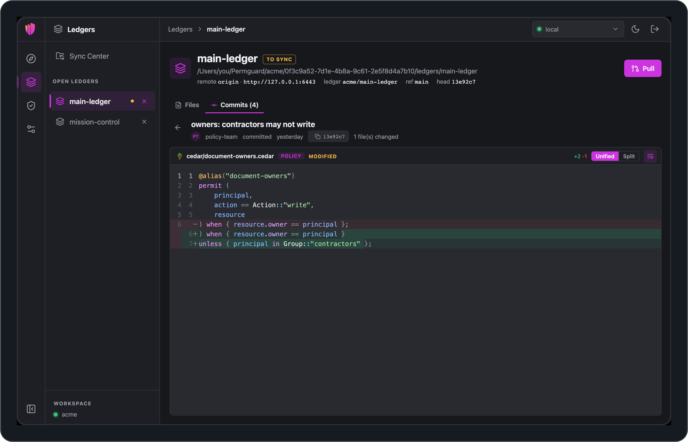
</p>

<details>
<summary><b>Browse the policies of a ledger</b></summary>

<p align="center">
  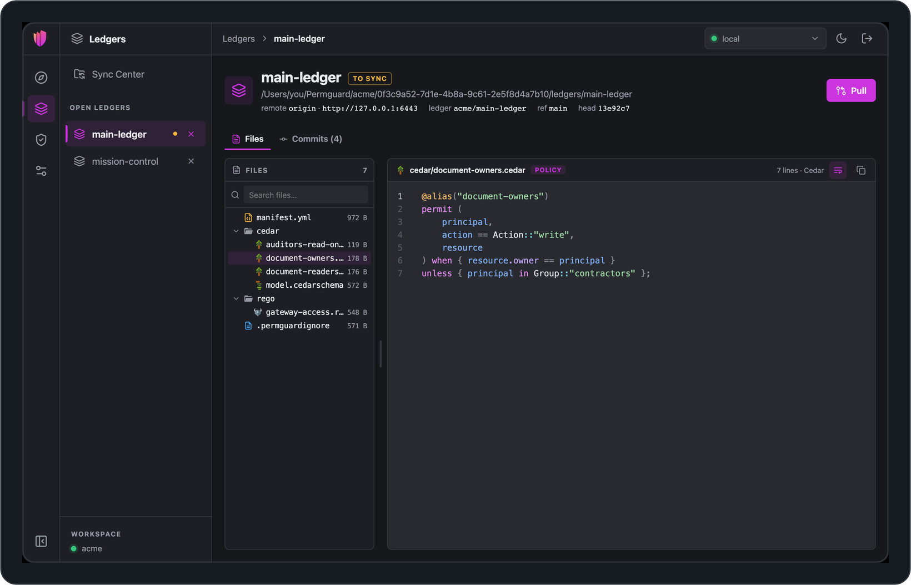
</p>

</details>

### Ask before you ship

Write a request, pick the ledger and the profile, and ask your data plane directly.
The answer comes back next to it, with the policies that decided it, how long it took, and the command line to ask the same thing again from a script.

<p align="center">
  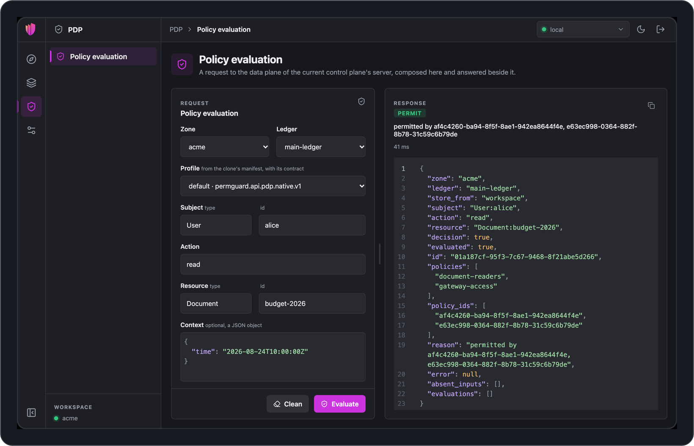
</p>

### Connect to all your Control Planes

Add your local Control Plane, staging and production side by side, over HTTP or gRPC, with TLS, mutual TLS and bearer tokens.
Switch between them from the top bar; a dot tells you at a glance which ones are online.

<p align="center">
  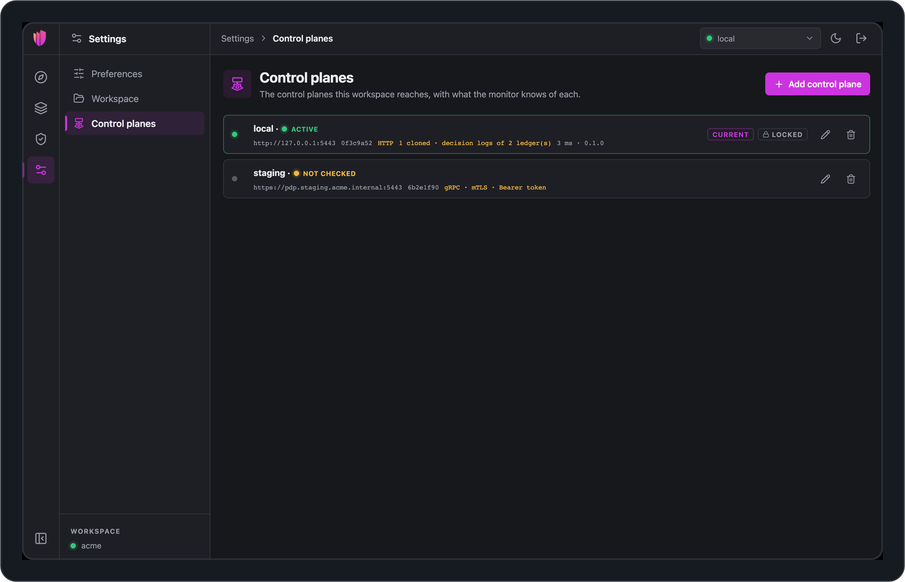
</p>

### Make it yours

Light, dark, or the one your system uses.
English, Italiano, Español and Français.

<p align="center">
  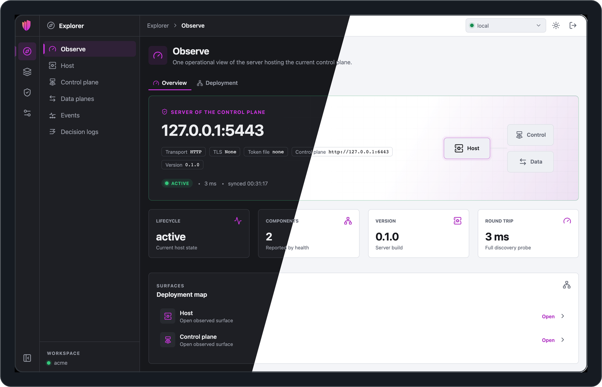
</p>

## Download

Get the latest version from the [Releases](https://github.com/permguard/permguard-admin-releases/releases/latest) page.

| System  | Download                                                 |
| ------- | -------------------------------------------------------- |
| macOS   | `_darwin_universal.dmg`, Apple silicon and Intel         |
| Windows | `_windows_amd64_setup.exe` or `_windows_amd64.msi`       |
| Linux   | `.deb`, `.rpm` or `.AppImage`, for `amd64` and `arm64`   |

Each release also carries `checksums.txt`, to check that the file you downloaded is the one we published:

```sh
shasum -a 256 -c checksums.txt --ignore-missing
```

## Install

### With Homebrew

On macOS, from the same tap as the Permguard command line:

```sh
brew trust permguard/tap      # once: Homebrew 7 loads casks only from trusted taps
brew install permguard/tap/permguard-admin
```

It installs the command line too, which Permguard Admin needs.
To install a given version, `brew install permguard/tap/permguard-admin@0.1.0`; to update, `brew upgrade permguard-admin`.

### With one command

The install scripts download the latest release, check it against `checksums.txt`, and install it.

**macOS and Linux:**

```sh
curl -fsSL https://raw.githubusercontent.com/permguard/permguard-admin-releases/main/install.sh | sh
```

**Windows**, in PowerShell:

```powershell
irm https://raw.githubusercontent.com/permguard/permguard-admin-releases/main/install.ps1 | iex
```

To install a given version, pass it to the script:

```sh
curl -fsSL https://raw.githubusercontent.com/permguard/permguard-admin-releases/main/install.sh | sh -s -- v0.0.2
```

```powershell
& ([scriptblock]::Create((irm https://raw.githubusercontent.com/permguard/permguard-admin-releases/main/install.ps1))) -Version v0.0.2
```

To read the script before running it, download it first, then run it:

```sh
curl -fsSLO https://raw.githubusercontent.com/permguard/permguard-admin-releases/main/install.sh
sh install.sh            # the latest release
sh install.sh v0.0.2     # a given version
```

```powershell
irm https://raw.githubusercontent.com/permguard/permguard-admin-releases/main/install.ps1 -OutFile install.ps1
powershell -ExecutionPolicy Bypass -File .\install.ps1                    # the latest release
powershell -ExecutionPolicy Bypass -File .\install.ps1 -Version v0.0.2    # a given version
```

| System  | What the script installs                                                                                                                       |
| ------- | ---------------------------------------------------------------------------------------------------------------------------------------------- |
| macOS   | the application, into `/Applications`, or `~/Applications` when that is not writable                                                           |
| Linux   | the `.deb` or the `.rpm`, whichever your system uses, otherwise the `.AppImage` in `~/.local/bin`; `-t deb`, `-t rpm` or `-t appimage` chooses |
| Windows | the setup, for your user, without administrator rights; `-Installer msi` installs the `.msi` for the whole machine                             |

### By hand

**macOS.**
Open the `.dmg` and drag Permguard Admin into Applications.

**Windows.**
Run the setup `.exe`, or the `.msi` for managed installations.

**Linux.**
Install the `.deb` with `sudo apt install ./permguard-admin_*.deb`, or the `.rpm` with `sudo dnf install ./permguard-admin_*.rpm`.
The `.AppImage` runs without installing: make it executable with `chmod +x` and start it.

If your system asks for confirmation the first time you open the application, confirm that you want to open it.

## Before you start

Permguard Admin works with the Permguard command line, which it uses to talk to your servers.
Installed with Homebrew, it is already there; otherwise install it first:

```sh
brew trust permguard/tap      # once, if not done already
brew install permguard/tap/permguard-cli
```

Other ways to install it are in the [Permguard documentation](https://docs.permguard.com/).
Then start Permguard Admin, choose a folder for your workspace, and connect it to a Permguard server: on your own computer, it finds the local one by itself.

<p align="center">
  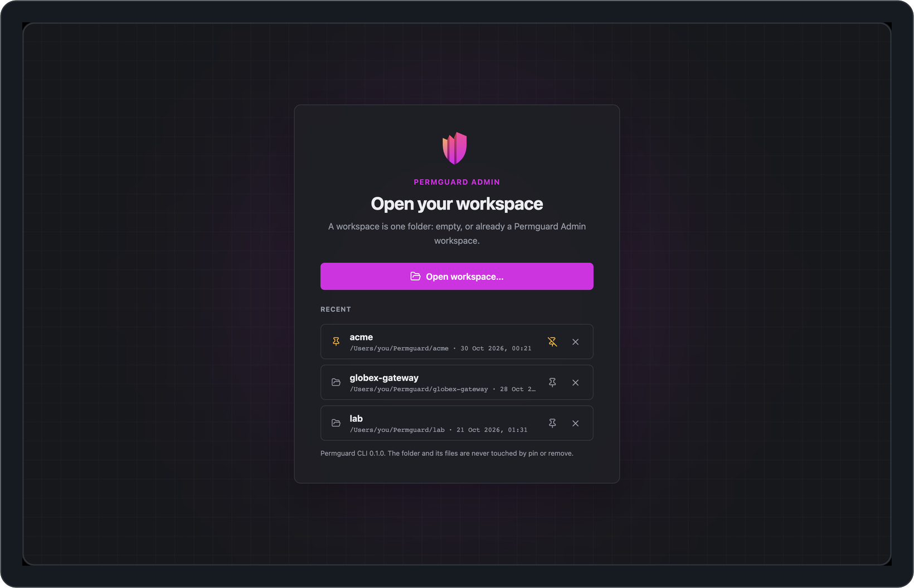
</p>

## Help

- **Documentation:** [docs.permguard.com](https://docs.permguard.com/)
- **Questions and problems:** [open an issue](https://github.com/permguard/permguard-admin-releases/issues)
- **Permguard itself:** [github.com/permguard/permguard](https://github.com/permguard/permguard)

## License

Permguard Admin is free to download and use under the terms in [LICENSE](LICENSE).
The open source components it includes, and their licences, are listed in [THIRD_PARTY_NOTICES.md](THIRD_PARTY_NOTICES.md).
Permguard® is a registered trademark of Nitro Agility S.r.l.
